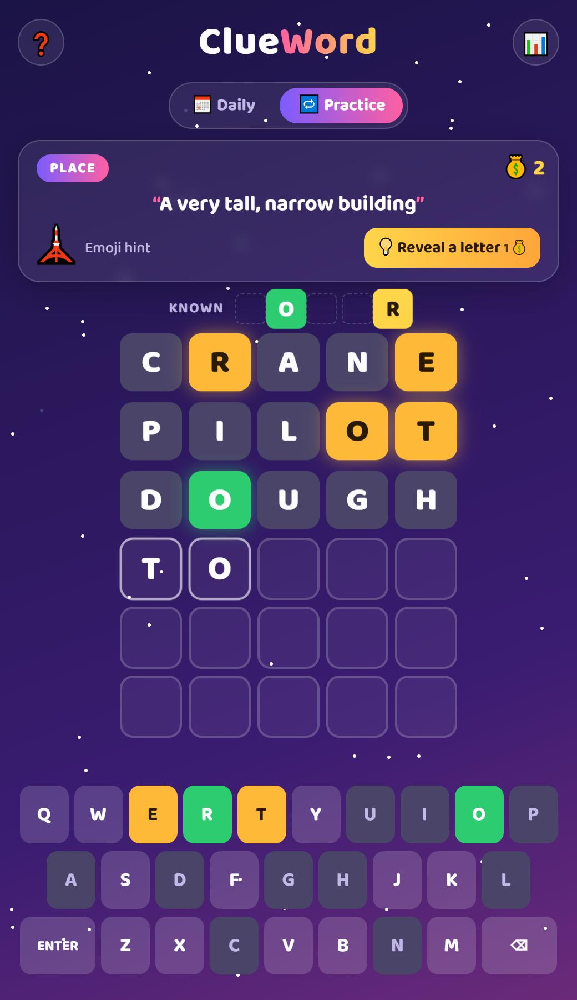

# 🌙 Clue Word

**A word-guessing game where every word comes with a riddle.**
Guess the hidden 5-letter word in 6 tries, helped by a clue, an emoji hint
and letter power-ups you earn by playing.

**▶️ Play it:** https://clueword.netlify.app

<p align="center">
  
</p>

---

## ✨ What makes it different from Wordle

|                       | Wordle            | **Clue Word**                                               |
| --------------------- | ----------------- | ----------------------------------------------------------- |
| Hint about the word   | ❌ none           | ✅ **riddle clue** + **category** from the first guess      |
| Extra help when stuck | ❌                | ✅ **emoji hint** unlocks after 3 guesses                   |
| Power-ups             | ❌                | ✅ **💡 Reveal a letter** with 💰 coins you earn by winning |
| Letters you've found  | only on the board | ✅ **"Known letters" strip** fills in automatically         |
| Scoring               | win / lose        | ✅ **points**: fewer guesses and fewer hints = more points  |
| Unlimited play        | ❌ one a day      | ✅ **Daily** word + unlimited **Practice**                  |

## 🎮 Features

- 📅 **Daily word:** the same word for every player each day, with no server needed
- 🔁 **Practice mode:** unlimited random words
- 🧩 **134 hand-written riddles** across categories like Animal, Food, Nature, Space and Fairy tale
- 💰 **Coin economy:** start with 3; +1 per win, +1 bonus when you win without letter hints
- 🟩🟨⬛ Colour hints with **correct handling of repeated letters**
- ⌨️ Real keyboard **or** on-screen keyboard (great on phones)
- 📊 Stats: games played, win %, streak 🔥, total points ⭐, guess distribution
- 📋 **Share** your result as an emoji grid with the clue, without spoiling the word
- 💾 Progress is saved, so refreshing doesn't lose today's game
- 🌌 Night-sky theme with twinkling stars, glowing tiles and confetti

## 🧠 How it works

**Same word for everyone, without a server.** Today's date becomes a day
number, and that number picks the word:

```js
ANSWERS[(day * 7919) % ANSWERS.length];
```

Multiplying by the prime 7919 mixes up the order, and every word is used once
before any word repeats.

**Fair scoring for repeated letters.** Each guess is checked in two passes:
first exact matches (green), then right-letter-wrong-place (yellow), but only
while that letter is still unused in the answer.

**Saving without a database.** Stats, coins and today's progress are stored in
the browser's `localStorage`.

**Word lists** (`words.js`):

- `ANSWERS`: 134 words, each with a category, an emoji and a hand-written riddle
- `VALID_GUESSES`: 12,653 five-letter English words, so any real word can be guessed

## 🛠️ Tech stack

HTML · CSS (Grid, animations, glassmorphism) · JavaScript · localStorage · Clipboard API

## 🚀 Run it locally

```bash
git clone https://github.com/faiza-mehram437/ClueWord.git
cd ClueWord
python -m http.server 8000
```

Then open **http://localhost:8000**. You can also just double-click `index.html`.

## 📁 Project structure

```
├── index.html   # page layout, clue card, help and stats pop-ups
├── style.css    # night-sky theme, board, keyboard, animations
├── game.js      # game logic: daily word, scoring, hints, coins, points, stats
└── words.js     # answers with clues + valid-guess list
```

## 🙏 Credits

- Inspired by _Wordle_ by Josh Wardle
- Valid-guess list from [an-array-of-english-words](https://github.com/words/an-array-of-english-words) (MIT licence)
- Font: [Baloo 2](https://fonts.google.com/specimen/Baloo+2) from Google Fonts

## 👩‍💻 Author

**Faiza Mehram**, [GitHub @faiza-mehram437](https://github.com/faiza-mehram437)
